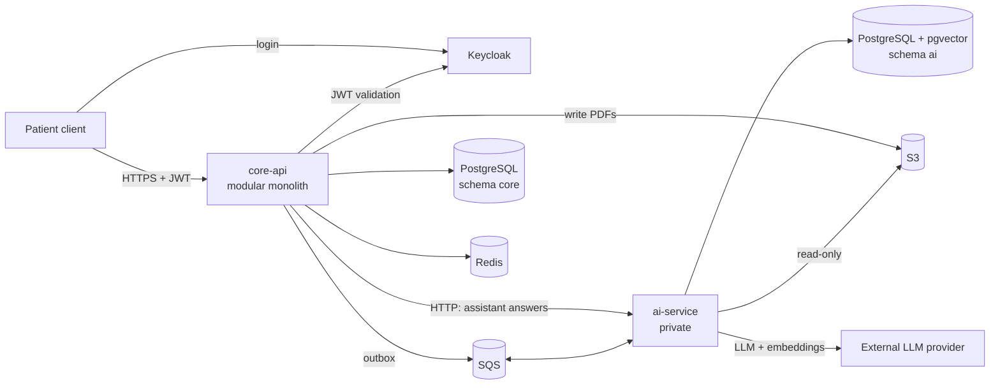

# Architecture

| Artifact | What it is |
| --- | --- |
| [Phase 1 document (Claude Docs)](https://claude.ai/artifact/FMtxAYDfMvwPQFYVzmzUni) | Product discovery, requirements, journeys, domain model, backlog |
| [Roadmap and module map (Whiteboard)](https://claude.ai/artifact/LCFxV5deWKXS1i1MCW3prb) | Visual roadmap and module dependencies |
| [`ddl-v1-proposal.sql`](ddl-v1-proposal.sql) | Executable schema proposal for `core` and `ai` (not a migration) |
| [`validate_ddl.sql`](validate_ddl.sql), [`validate_ddl.sh`](validate_ddl.sh) | Assertions: invariants, dedupe, privilege separation, RLS, index usage |
| [`../../contracts/core-api.openapi.yaml`](../../contracts/core-api.openapi.yaml) | Public API design (OpenAPI 3.1) |
| [`../../contracts/events/`](../../contracts/events/) | Queue message contracts (JSON Schema) |
| [`observability.md`](observability.md) | Metrics, traces, local telemetry stack and privacy rules for telemetry |
| [`../adr/`](../adr/) | Architecture decisions |
| [`../security/`](../security/) | Threat model and privacy requirements map |

## Container view



## Validating the DDL

```bash
ADMIN_URL=postgresql://postgres@localhost:5432/postgres docs/architecture/validate_ddl.sh
```

Expected output ends with `ALL DDL ASSERTIONS PASSED`. From Phase 3 this runs in CI against a `pgvector/pgvector:pg16` container.
