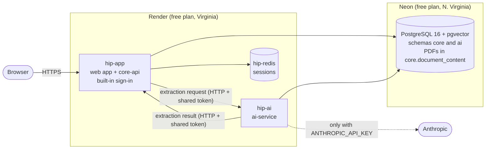
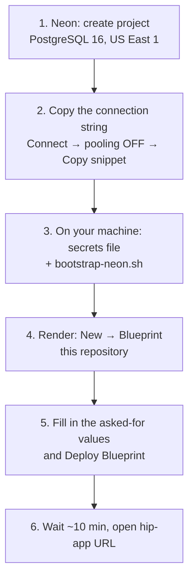

# Free demo on Render

**Live demo: https://hip-app.onrender.com** (synthetic data only; create an account on the first page).

The demo costs nothing. It runs on **Render** (free web services and Key Value) and **Neon** (free PostgreSQL that does not expire). It is not hardened for real patients (ADR 0015), so never upload a real lab report.

## How it fits together



| Piece | What it is | Plan |
| --- | --- | --- |
| `hip-app` | core-api, the web app and the built-in sign-in, in one image (`render/app.Dockerfile`) | Render, free |
| `hip-ai` | ai-service (`ai-service/Dockerfile`) | Render, free |
| `hip-redis` | sessions, rate limits, idempotency keys | Render Key Value, free |
| database | PostgreSQL 16 + pgvector | Neon, free |

## What to expect

- **Slow first page.** Each service sleeps after about 15 minutes without traffic and takes about a minute to wake up.
- **The AI is off.** Without `ANTHROPIC_API_KEY`, uploads stay "em processamento" and the assistant says it is unavailable. Everything else works: accounts, onboarding, uploads and downloads, health records, and data export and deletion. To turn it on, add the key in Render (hip-ai → Environment), from an Anthropic account with a spending limit.
- **Sign-ins do not survive restarts.** Key Value keeps nothing on disk. If it restarts, everyone signs in again.
- **Free hours are shared.** The 750 free instance hours a month cover every free service in the Render workspace.

## Deploying it again from scratch



### 1–2. Neon

1. Create a free Neon account and a project with **PostgreSQL 16** in **AWS US East 1 (N. Virginia)**. The database is `neondb`.
2. Click **Connect**, turn **Connection pooling off**, and copy the connection string. Migrations need the direct host, the one without `-pooler`.

### 3. Prepare the database (once, from your machine)

You need `psql` (`brew install libpq`). Create a private secrets file. `.run/` is ignored by git.

```bash
mkdir -p .run && umask 077 && { echo "NEON_DATABASE_URL='paste-the-connection-string-here'"; for v in CORE_OWNER_PASSWORD CORE_APP_PASSWORD AI_OWNER_PASSWORD AI_APP_PASSWORD; do echo "$v=$(openssl rand -hex 24)"; done; } > .run/render-secrets.env
```

Paste the connection string into the file, then run the bootstrap:

```bash
set -a && . .run/render-secrets.env && set +a && ./scripts/render/bootstrap-neon.sh
```

The script creates the four roles, the `core` and `ai` schemas and pgvector, and never prints the passwords. Tables are created by core-api (Flyway) and ai-service (Alembic) on their first start. Running it again only resets the passwords.

### 4–5. Render

1. Create a free Render account. Then go to **New → Blueprint** and either connect the GitHub repository or paste its public URL. Only the GitHub connection gives automatic deploys on every push to `main`. With the public URL, use **Manual Deploy**.
2. Render reads `render.yaml` and asks for these values:

| Variable | Service | Value |
| --- | --- | --- |
| `CORE_DB_URL` | hip-app | `jdbc:postgresql://<neon host>/neondb?sslmode=require` |
| `CORE_OWNER_PASSWORD`, `CORE_APP_PASSWORD` | hip-app | from `.run/render-secrets.env` |
| `AI_SERVICE_URL` | hip-app | `https://hip-ai.onrender.com` |
| `AI_DB_HOST` | hip-ai | the Neon host only, e.g. `ep-xxxx.c-16.us-east-1.aws.neon.tech` |
| `AI_OWNER_PASSWORD`, `AI_APP_PASSWORD` | hip-ai | from `.run/render-secrets.env` |
| `AI_CORE_API_URL` | hip-ai | `https://hip-app.onrender.com` |
| `ANTHROPIC_API_KEY` | hip-ai | leave empty, or see *What to expect* |

Render generates `HIP_INTERNAL_TOKEN` (shared by both services) and `DOCUMENTS_LINK_SECRET`.

3. Click **Deploy Blueprint**. The first build takes about 10 minutes. If Render gave a service another URL (the name was taken), correct `AI_SERVICE_URL` or `AI_CORE_API_URL` and redeploy.

### 6. Check

```bash
curl -s -o /dev/null -w '%{http_code}\n' https://hip-app.onrender.com/actuator/health/readiness
```

`200` means it is up. Anonymous calls to `/api/...` should answer `401`.

## How it differs from the full architecture

| Full stack (compose, AWS) | Render profile | Setting |
| --- | --- | --- |
| Keycloak + BFF, tokens never in the browser | Built-in e-mail and password sign-in in core-api; same session cookie and CSRF rules | `hip.auth.mode=local`, `VITE_AUTH_MODE=local` |
| PDFs in S3, pre-signed links | PDFs in `core.document_content`, HMAC-signed links | `hip.documents.store=database` |
| SQS between core-api and ai-service | Direct HTTP calls in both directions | `hip.messaging.transport=http`, `AI_MESSAGING_TRANSPORT=http` |
| Keycloak client-credentials tokens between services | One shared secret | `HIP_INTERNAL_TOKEN` |
| nginx serves the SPA | core-api serves it, with the same headers | `hip.spa.directory` |

All of this lives in the `render` Spring profile (`core-api/src/main/resources/application-render.yml`). The defaults and the AWS design are unchanged.
